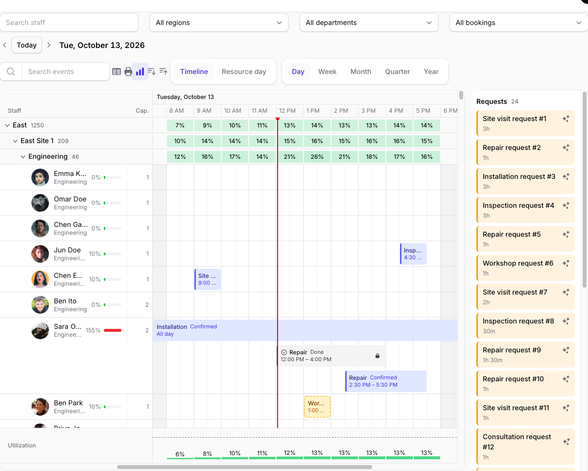
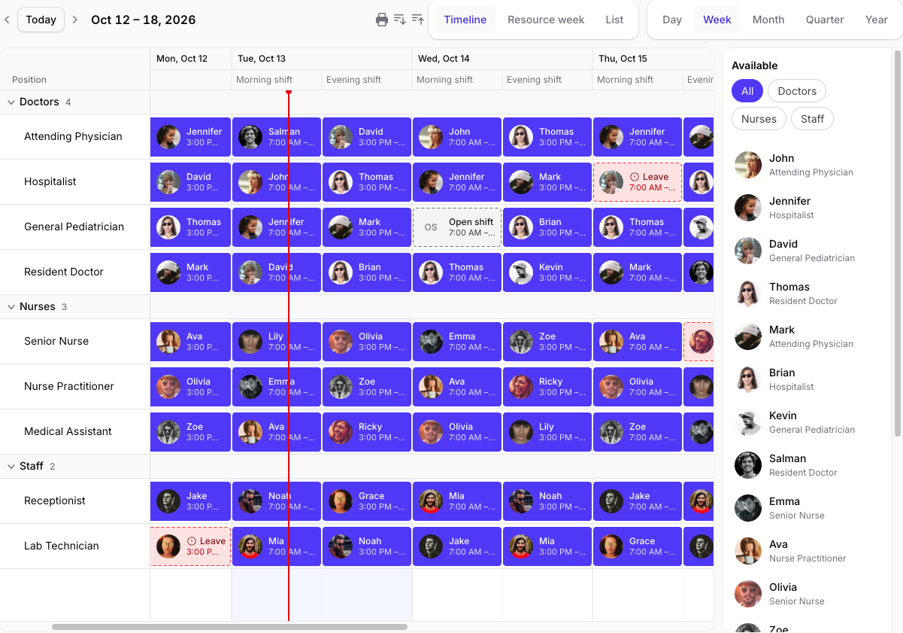
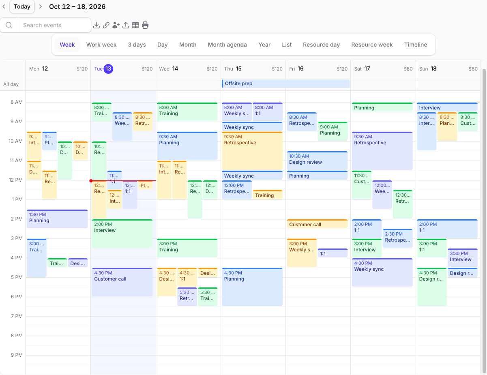
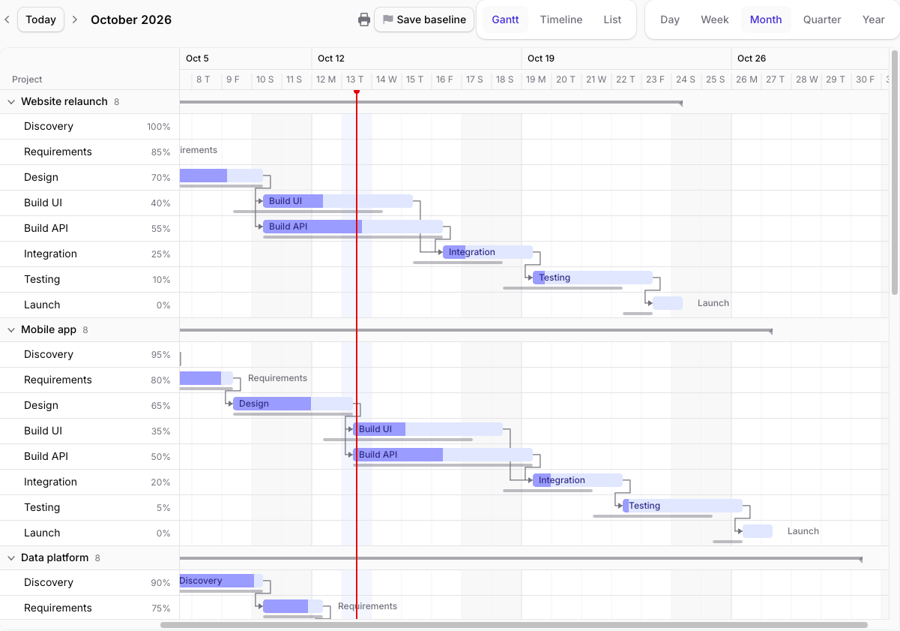
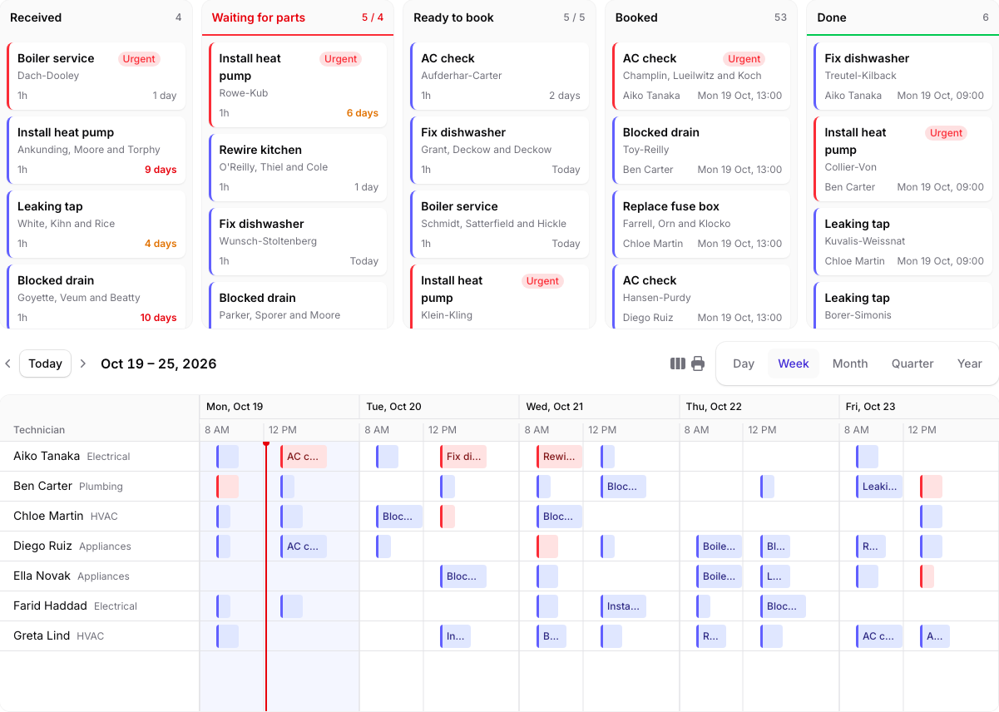

# Warp Scheduler



**A resource scheduler for Filament that stays fast with thousands of rows: the timeline, calendars and Gantt chart are drawn on a `<canvas>`, while forms, actions, filters, notifications and permissions are Filament's own.**

<a href="https://demo.warpui.com/scheduler"></a>

Scroll through 5,000 people, drag bookings, cover shifts, dispatch jobs and plan a project at **[demo.warpui.com/scheduler](https://demo.warpui.com/scheduler)**. No sign-up needed; the data is reset every hour.

Calendar plugins for Filament wrap a JavaScript calendar in a widget. That works for a few dozen resources, but a planning board with hundreds or thousands of people, rooms or machines needs more: a resource timeline that does not build a DOM node per cell, recurring events that are expanded on the server, rules that stop double bookings, and a way to see how busy each resource is.

Warp Scheduler keeps your Eloquent models. Point it at a resource model and one or more event models, and you get a resource timeline, resource day and week views, week, work week, day, N-day, month, month agenda, year and list views and a Gantt chart, with drag and drop that saves through your policies.

```php
use Qalainau\FilamentWarpScheduler\EventSource;
use Qalainau\FilamentWarpScheduler\Pages\SchedulerPage;
use Qalainau\FilamentWarpScheduler\Scheduler;

class StaffSchedule extends SchedulerPage
{
    public function scheduler(Scheduler $scheduler): Scheduler
    {
        return $scheduler
            ->resources(Staff::class)
            ->groupResourcesBy(['region', 'department'])
            ->events([
                EventSource::make(Booking::class)
                    ->resource('staff_id')
                    ->start('starts_at')
                    ->end('ends_at')
                    ->title('title'),
            ]);
    }
}
```

## Why

Measured on the demo app with 5,148 timeline rows (5,000 staff in three levels of groups) and 200,000 bookings, in Chrome:

| | |
| --- | --- |
| Page HTML, including every resource | 44 KB |
| First events on screen after navigation | about 0.2 s |
| Drawing a frame while scrolling (any zoom) | 3 ms or less |
| Utilization for a month of 200,000 bookings | about 0.4 s |

Only the rows and the time range on screen are drawn, and events are loaded per block of 100 resources as you scroll.

## Features



- **Views**: resource timeline (day, week, month, quarter and year zoom), resource day and week views (by resource or by date), week, work week, day, N-day, month, month agenda, year and list views, and a Gantt chart. Each view and each timeline zoom can have its own slot size, row height, visible hours and days, and the tabs can be renamed from PHP. The week and month zooms can stack each day's events in time order as full-width blocks, so a busy route stays readable with Monday to Friday on one screen.
- **Built for large boards**: canvas rendering with vertical and horizontal virtualization, collapsible nested resource groups, lazy loading of events and placeholders while they load.
- **Drag and drop**: move events in time and across resources, copy with Alt, resize from either edge, select several with Ctrl/Cmd+click and drag them together, copy and paste, rename in place, and create events by selecting a range. Changes appear at once and are saved on the server, which checks read-only mode, locked events and your model policies. Refused changes roll back with a notification.
- **Board (kanban)**: show the same records in columns by stage above or beside the timeline. Drag a card to another column to change its stage, onto a resource to schedule it, or drag an event from the timeline back to the board to take it off the timeline. WIP limits, the days each card has waited, and columns built from your own enum.
- **Drop from anywhere**: drop unscheduled records from a pool, rows from a Filament table or any element on the page, people from a side list onto shifts, or events from another scheduler. Book a request into the first free slot with one click.
- **Your content**: subtitles, icons, badges, avatars and solid, outline or dashed styles on events; server-rendered tooltips and a quick-info popup; resource avatars, descriptions and extra columns; holidays, prices per day and labelled blocked time; shifts as header rows.
- **Filament actions**: each event source with a schema gets create, edit and delete actions in Filament modals. Add your own actions to the event context menu with `eventActions()`, and add, edit or delete resources on the board.
- **Recurring events**: RFC 5545 rules expanded on the server for the visible range, with the wall-clock time kept across daylight saving changes. Edit or delete one occurrence, this and following, or the whole series. `RecurrenceInput` adds a repeat section to your form, including the nth weekday of a month and chosen months.
- **Availability and conflicts**: business hours, per-resource and date exceptions such as holidays, blocked time, and capacity. Rules reject or only warn, are checked on the server before saving, and are previewed in red or amber while dragging.
- **Utilization**: booked time over available time per resource, per group and per hour, day, week or month, shown as meters, group heatmaps and a histogram.
- **Gantt**: progress, baselines, dependency arrows (finish-to-start, start-to-start, finish-to-finish and start-to-finish, with lag), the critical path, and successors that move along when a task is pushed later. Link tasks by dragging between bars.
- **Data**: events shared by several resources (`belongsToMany`), read-only events from any callback, search, reminders as database notifications, CSV and XLSX export and `.ics` import.
- **iCal**: download the visible range as `.ics`, or subscribe from Google Calendar, Apple Calendar or Outlook with a personal link that keeps the user's filters and tenant.
- **Two-way calendar sync**: connect a Google or Microsoft calendar to a resource. Changes on either side are synced through queued jobs, push notifications and delta queries.
- **Print and PDF**: print the current view or a date range, landscape or portrait, in the light palette, page by page, or save it as a PDF from the print dialog.
- **Filament integration**: a page, a dashboard widget, or a trait for any Livewire component. Filter form built from Filament fields, multi-tenancy for SaaS apps, dark mode, panel colors, translations (English, Japanese, German, French, Spanish, Italian, Brazilian Portuguese, Korean and Chinese, simplified and traditional), SPA mode, a compact layout on phones and right-to-left languages. Hooks after every change, and browser events.
- **Accessibility**: keyboard navigation and editing, a screen reader list of the events on screen (title, time and resource) that also makes them findable with the browser's find and by automated tests, and live announcements of saves.
- **Browser tests**: `eventRects()` tells where each event is on the screen, and `whenIdle()` waits until the board has loaded and saved.

| Calendar views | Gantt chart |
| --- | --- |
|  |  |

## Requirements

- PHP 8.3+
- Laravel 12 or 13
- Filament 5.x (Livewire 4)
- A queue worker if you use calendar sync

## Installation

> **Warp Scheduler is a commercial plugin.** A license is required. After purchase you receive credentials for the private Composer repository.

Add the repository and authenticate:

```bash
composer config repositories.qalainau composer https://qalainau.privato.pub/composer
composer config --auth http-basic.qalainau.privato.pub "your-email" "your-license-key"
```

Install the package, run the migrations and publish Filament's assets:

```bash
composer require qalainau/filament-warp-scheduler
php artisan migrate
php artisan filament:assets
```

The migrations create the plugin's own tables (`warp_scheduler_*`) for recurrence rules, availability, blocked time, dependencies, baselines, iCal links and calendar connections. Your event and resource tables are not changed. To edit the migrations, publish them with `php artisan vendor:publish --tag=filament-warp-scheduler-migrations`. Publish them before you run `php artisan migrate` for the first time: Warp Scheduler then runs your copy instead of its own. If the tables already exist, change them with a migration of your own instead.

> Run `php artisan filament:assets` again after every update of the package.

### AI coding assistants (Laravel Boost)

Warp Scheduler ships instructions for AI coding assistants such as Claude Code, Cursor and Codex. If your app uses
[Laravel Boost](https://laravel.com/docs/boost), the assistant learns how to use Warp Scheduler from them: which
classes to extend, how to save changes and refuse them, what is easy to get wrong, and how to test a scheduler.

- **Guidelines** (`resources/boost/guidelines/core.md`): a short summary that Boost adds to `CLAUDE.md`,
  `AGENTS.md` and the other agent files. It also points the assistant to this README in `vendor/`, so it reads the
  documentation of the version you have installed instead of guessing.
- **Skill** `warp-scheduler-development` (`resources/boost/skills/`): the steps for adding a board, saving through your
  own code, and writing feature and browser tests. The assistant loads it when it works on a scheduler.

Boost does not add guidelines of other vendors' packages on its own. When `php artisan boost:install` asks
"Which third-party AI guidelines/skills would you like to install?", select `qalainau/filament-warp-scheduler`. To do
it without the question, add the package to `boost.json` and run the command again:

```json
{
    "packages": ["qalainau/filament-warp-scheduler"]
}
```

```bash
php artisan boost:install --guidelines --skills -n
```

After you update Warp Scheduler, run `php artisan boost:update` so the assistant gets the instructions of the new
version.

## Usage

### Where to put a scheduler

Extend `SchedulerPage` for a full page or `SchedulerWidget` for a dashboard widget, and implement `scheduler()`:

```php
use Qalainau\FilamentWarpScheduler\Widgets\SchedulerWidget;

class TodaySchedule extends SchedulerWidget
{
    public function scheduler(Scheduler $scheduler): Scheduler
    {
        return $scheduler->height(360)->initialZoom(TimelineZoom::Day)->resources(...)->events([...]);
    }
}
```

If you give the widget a view of its own, keep `<x-filament-actions::modals />` in it: a widget renders its own
create, edit and delete modals, unlike a page.

In any other Livewire component (for example a resource's relation page), implement `HasScheduler`, `HasSchemas` and `HasActions`, use `InteractsWithScheduler`, `InteractsWithSchemas` and `InteractsWithActions`, and render `{{ $this->getWarpScheduler() }}`. If the component is not a Filament page, also render `<x-filament-actions::modals />` so that the create, edit and delete modals can open. The scheduler's properties and methods are prefixed with `warpScheduler`, so they do not clash with `$record` or your own properties.

### Resources

```php
$scheduler
    ->resources(fn (array $filters) => Staff::query()->where('active', true))   // a model class, a query or a collection
    ->resourceTitle('name')                                                     // or fn (Staff $record): string
    ->resourceLabel('Staff')                                                    // the column heading
    ->groupResourcesBy(['region', 'site'])                                      // nested groups, attributes or closures
    ->resourceColumnWidth(240)
    ->rowHeight(36);
```

A resource model can implement `SchedulerResource` (`getSchedulerTitle()` and `getSchedulerGroups()`) instead.

### Events

```php
EventSource::make(Booking::class)
    ->label('Booking')
    ->resource('staff_id')
    ->start('starts_at')
    ->end('ends_at')               // the end is exclusive
    ->title('title')               // or fn (Booking $record): string
    ->allDay('all_day')            // a boolean column, or true for date-only models
    ->color(fn (Booking $record): string => $record->status === 'tentative' ? 'warning' : 'primary')
    ->modifyQueryUsing(fn (Builder $query, array $filters) => $query->where('status', '!=', 'cancelled'))
    ->schema([...])                // the create and edit form
    ->locked(fn (Booking $record): bool => $record->status === 'done')
    ->editable(true)
    ->resizable(true);
```

An event model can implement `Schedulable` (`getSchedulerColumns()`) to declare its columns once. Pass several sources to `events()` to show several models on the same board.

All-day events are floating dates, like iCalendar: they stay on the same day in every time zone.

Dates are stored as wall-clock times in the app time zone (`app.timezone`), as Laravel does. The scheduler shows them
in its own time zone (`timezone()`, by default Filament's), and the app, Filament and the scheduler can each use a
different zone.

Event content, tooltips and the quick-info popup:

```php
EventSource::make(Booking::class)
    ->subtitle('status')                                   // drawn after (or under) the title
    ->icon(fn (Booking $record) => $record->urgent ? Heroicon::OutlinedBolt : null)
    ->badge(fn (Booking $record): ?string => $record->seats)
    ->tooltip(fn (Booking $record) => view('bookings.tooltip', ['booking' => $record]))  // loaded on hover
    ->details(fn (Booking $record): string => $record->notes); // shown in the quick-info popup

$scheduler->quickInfo();  // clicking an event shows its details and actions instead of opening the modal
```

Strings are escaped; return an `Htmlable` (a view or `HtmlString`) for markup.

#### Events without the time in the box

By default an event box shows its time: before the title on a short box, and as a second line ("07:20 – 08:00")
on a box 34px tall or more. When the time is already clear from where the box sits, or the box should only name
the job, turn it off with `showTime(false)`. The box then shows the title, and the subtitle as its second line:

```php
EventSource::make(Delivery::class)
    ->title(fn (Delivery $record): string => $record->customer->name)
    ->subtitle(fn (Delivery $record): string => $record->order_number)
    ->showTime(false);   // or fn (Delivery $record): bool => ... per event
```

- `showTime(bool|Closure $condition = true)`: whether the box draws the time. A closure receives the record
  (`fn (Delivery $record): bool`), so some events can keep their time.
- Only the box changes. The tooltip, the quick-info popup, the label while dragging, the list views, the board
  cards and the screen reader text still give the time.
- All-day events never show a time, so the setting makes no difference to them.

Avatars, solid or dashed events and shifts:

```php
$scheduler
    ->resourceImage(fn (Staff $record): ?string => $record->avatar_url)  // rows become 52px tall by default
    ->shifts(['Morning shift' => ['06:00', '14:00'], 'Evening shift' => ['14:00', '22:00']]);

EventSource::make(Shift::class)
    ->image(fn (Shift $record): ?string => $record->employee->avatar_url)
    ->variant(fn (Shift $record): string => $record->on_leave ? 'dashed' : 'solid');  // soft, solid, outline, dashed
```

People without an image get their initials. Blocked time shows its reason. Images from other sites must allow
CORS to appear in printouts.

A side list of things to drag onto the board (people who can take a shift, for example), with group filters:

```php
$scheduler
    ->sideList(fn (): array => Employee::available()->get()->map(fn (Employee $employee): array => [
        'id' => $employee->id, 'title' => $employee->name, 'subtitle' => $employee->role,
        'image' => $employee->avatar_url, 'group' => $employee->team,
    ])->all(), label: 'Available')
    ->onExternalDrop(function (array $data, CarbonImmutable $start, ?Model $resource, ?Model $event): ?Model {
        // dropped on an event: replace who covers it; dropped on an empty slot: create one
        // return the record you created or changed, so the scheduler can draw it at once
    });
```

If the callback returns nothing (or creates several records), the scheduler fetches the visible events again.

Resource column, day cells and holidays:

```php
$scheduler
    ->resourceDescription('department')
    ->resourceColor(fn (Staff $record): string => $record->team_color)
    ->resourceColumns(['capacity' => 'Seats', 'floor' => ['label' => 'Floor', 'width' => 56]])
    ->dayCellContent(fn (CarbonImmutable $date): ?string => $prices->for($date))
    ->holidays(fn (CarbonImmutable $from, CarbonImmutable $to): array => Holiday::between($from, $to)->pluck('name', 'date')->all());
```

Holidays are shaded like weekends and named in the month, week and year views. With Warp DatePicker, `useWarpDatePicker()` brings its holidays, company days off and business hours instead (see [Holidays and business hours from Warp DatePicker](#holidays-and-business-hours-from-warp-datepicker)).

Events shared by several resources (a meeting with many rooms) use a `belongsToMany` relationship instead of a column.
The event is drawn on every resource; dragging one row moves that assignment, and the time of all of them:

```php
EventSource::make(Meeting::class)->resourcesRelationship('rooms');
```

Use a multiple `Select::make('rooms')->relationship('rooms', 'name')` in the form. Recurring events need a resource column.

Reminders send a Filament database notification before an event starts:

```php
EventSource::make(Booking::class)
    ->reminders([15, 60 * 24])                              // minutes before
    ->remindTo(fn (Booking $record) => $record->staff->user)
    ->remindUsing(fn (Booking $record, int $minutesBefore) => ...); // or send them yourself
```

List the scheduler components in `filament-warp-scheduler.reminders.components` and run
`Schedule::command('warp-scheduler:send-reminders')->everyMinute()`. Each reminder is sent once; moving an event
sends it again for the new time.

### Import, export and other data

```php
$scheduler
    ->exportable()                 // CSV and XLSX of the visible range (or ->exportable(['csv']))
    ->icsImport()                  // upload an .ics file into a resource
    ->eventsUsing(fn (CarbonImmutable $start, CarbonImmutable $end, array $resources): array => $api->events($start, $end))
    ->resourceSchema([TextInput::make('name')->required()]);  // add, edit and delete resources on the board
```

`eventsUsing()` returns arrays with `id`, `resource`, `start`, `end`, `title` and optionally `allDay`, `color` and
`subtitle`; those events are read-only. With `resourceSchema()`, click a resource name to edit it, right-click it to
delete it, and use the toolbar button to add one. Model policies apply.

### Views and time

```php
$scheduler
    ->views([SchedulerView::ResourceTimeline, SchedulerView::Week, SchedulerView::Month])  // default: all
    ->initialView(SchedulerView::ResourceTimeline)
    ->initialZoom(TimelineZoom::Week)
    ->initialDate('2026-10-01')
    ->timezone('Asia/Tokyo')        // default: FilamentTimezone
    ->firstDayOfWeek(1)
    ->height('70vh')
    ->calendarResourceLimit(300);   // week, day, month and list show all events together
```

Slots, visible days and hours, and header rows:

```php
$scheduler
    ->slotDuration(15)              // time grid slots, minutes (default 30)
    ->snapDuration(5)               // drag, resize and selection rounding, minutes
    ->slotHeight(20)                // time grid slot height, px
    ->slotWidth(64)                 // minimum width of the finest timeline tick (slotDuration in the day and week zooms), px
    ->scrollTime('08:00')           // where to scroll when today is not in range
    ->workingDays([1, 2, 3, 4, 5])  // default: days with business hours, else Monday to Friday
    ->hideNonWorkingDays()          // or ->hiddenDays([0, 6])
    ->visibleHours('07:00', '21:00') // or ->hideNonWorkingHours() to use the business hours
    ->headerRows([HeaderRow::Month, HeaderRow::Week, HeaderRow::Day])
    ->viewSettings([
        SchedulerView::ResourceTimeline->value => ['hiddenDays' => [0, 6], 'visibleHours' => ['08:00', '20:00']],
        SchedulerView::Week->value => ['slotDuration' => 10],
        SchedulerView::Gantt->value => ['rowHeight' => 44],
    ]);
```

To change these settings per timeline zoom as well, see [Settings per zoom](#settings-per-zoom).

More views are available on demand (the default set is `SchedulerView::defaults()`):

| View | Shows |
|---|---|
| `ResourceWeek` / `ResourceWeekByDate` | A week of days per resource, or every resource per day |
| `WorkWeek` | The working days of the week (`workingDays()`) |
| `Days` | Any number of days (`dayCount(3)`) |
| `MonthAgenda` | A compact month with the selected day's events listed below |
| `Year` | Twelve mini months shaded by how busy each day is; click a day to open it |

Hidden days and hours are left out of the timeline (hour zooms squeeze the night away), the week and month
grids and the time grids. Header rows finer than the zoom are skipped. With only day rows (or coarser) in the Day or
Week zoom (`headerRows([HeaderRow::Day])`), each day is one cell, without hour lines.

#### Height of the board

By default the board is a box as high as the window (minus the page header) and scrolls inside. `height()` sets
another fixed height. With `'auto'` the box of the resource timeline and the Gantt view is as high as its content
instead: the header, every row and the utilization band right under the last row. Four vans make a short board; the
page scrolls when the rows are taller than the window.

```php
use Qalainau\FilamentWarpScheduler\Enums\TimelineZoom;

$scheduler
    ->height('auto', max: '80vh')       // as high as the rows, at most 80% of the window
    ->zoomSettings([
        TimelineZoom::Day->value => ['height' => 'auto'],   // or per zoom only
        TimelineZoom::Week->value => ['height' => 640],     // a fixed 640px for the week
    ]);
```

- `height(int|string|Closure|null $height, int|string|Closure|null $max = null)`: a number is pixels, a string any
  CSS length (`'70vh'`, `'40rem'`) or `'auto'`. `null` (the default) is the window-high box.
- `max` only counts with `'auto'`: past it, the rest of the rows scroll inside the box as usual. Use it for long
  resource lists (the board is drawn as one canvas as high as the box, so hundreds of rows make a very large canvas).
- `height` in `zoomSettings()` (or `viewSettings()`) takes the same values and overrides `height()` while that zoom
  (or view) is shown. Switching the zoom resizes the box at once: a stacked week grows with its stops, the day shrinks
  back.
- The box follows the rows as they change: events loading into more lanes, a stacked day getting busier, groups
  opening and closing, the utilization band switched on or off.
- `'auto'` applies to the views with rows (the resource timeline and the Gantt view). The calendar, month, list and
  other views keep the default height.

#### Choosing the timeline zooms

The resource timeline has five zooms: Day, Week, Month, Quarter and Year. Some boards only make sense at a few of
them (a delivery route for one day is a row of thin stripes at Year), so you can choose which zooms the toolbar
offers:

```php
use Qalainau\FilamentWarpScheduler\Enums\TimelineZoom;

$scheduler
    ->timelineZooms([TimelineZoom::Day, TimelineZoom::Week])  // the buttons, in this order
    ->initialZoom(TimelineZoom::Day);
```

- `timelineZooms(array|Closure|null $zooms)`: `TimelineZoom` cases or their values (`'day'`, `'week'`, ...). The
  default (`null` or an empty array) offers all five. An unknown value throws a `ValueError`.
- With a single zoom, the zoom buttons are not shown at all.
- If `initialZoom()` is not one of them, the scheduler starts on the first zoom in the list.
- A zoom that is not allowed is never shown: switching to one from JavaScript
  (`$refs.stage.warpScheduler.setZoom('year')`) goes to the first allowed zoom instead, and so does a page update
  (a filter, for example) that takes the current zoom out of the list.
- The other views (week, month, list and so on) have their own range and are not affected.

#### Settings per zoom

The slot width, the time steps and the row height that suit a day rarely suit a quarter. `viewSettings()` changes them
per view; `zoomSettings()` changes them per timeline zoom, on top of the view settings:

```php
use Qalainau\FilamentWarpScheduler\Enums\TimelineZoom;

$scheduler
    ->timelineZooms([TimelineZoom::Day, TimelineZoom::Week, TimelineZoom::Month])
    ->slotWidth(64)
    ->rowHeight(40)
    ->zoomSettings([
        // a delivery day: wide 15-minute ticks, tall rows for two lines of text, drops round to 5 minutes
        TimelineZoom::Day->value => ['slotWidth' => 96, 'slotDuration' => 15, 'snapDuration' => 5, 'rowHeight' => 64],
        // the week: hour ticks, 8px per hour, and compact rows
        TimelineZoom::Week->value => ['slotDuration' => 60, 'slotWidth' => 8, 'rowHeight' => 32],
        // Month is not listed, so it uses slotWidth(64) and rowHeight(40)
    ]);
```

- `zoomSettings(array|Closure $settings)`: the keys are zooms (`TimelineZoom` values: `'day'`, `'week'`, `'month'`,
  `'quarter'`, `'year'`), the values the same settings as `viewSettings()`: `slotWidth`, `slotDuration`,
  `snapDuration`, `rowHeight`, `headerRows`, `visibleHours`, `hiddenDays`, `scrollTime`, `eventLayout` (see
  [Stacking each day's events](#stacking-each-days-events)), `height` (see [Height of the board](#height-of-the-board))
  (and `slotHeight`, `dayCount`, `shifts`, which the
  timeline does not use). Only the settings you give change; the others come from the
  view settings, then from the scheduler-wide methods (`slotWidth()`, `rowHeight()` and so on).
- The order is: scheduler-wide settings, then `viewSettings()` for the view, then `zoomSettings()` for the zoom shown.
- As without zooms, `slotDuration` (the fine ticks) and `snapDuration` (the drag rounding) are used by the Day and
  Week zooms; the Month, Quarter and Year zooms round to whole days.
- They apply to the views with zooms (the resource timeline and the Gantt view). The week, month, list and other
  views ignore them.
- Switching the zoom switches the settings at once: the ticks, the row heights and the drag rounding change with it,
  and switching back restores them.
- `rowHeight` is the height of one lane of a resource row in pixels, at least 20. It can also go in `viewSettings()`
  (for example a taller Gantt view).
- `slotWidth` is the minimum width of the finest tick: one `slotDuration` in the Day and Week zooms (30 minutes
  unless you change it), one day in the Month and Quarter zooms, one week in the Year zoom. The Week above, with
  `slotDuration => 60` and `slotWidth => 8`, is 8px per hour: 7 × 24 × 8 = 1344px, less with hidden hours and days.
  If the screen is wider, the range is stretched to fill it. Without `slotWidth`, each zoom keeps its built-in width.
- An unknown zoom throws a `ValueError`, an unknown setting an `InvalidArgumentException`.
- Without `zoomSettings()`, nothing changes from before.

#### Stacking each day's events

On a week of delivery routes, a van has ten stops a day, one after another. Placed by time, each stop is a stripe a
few pixels wide; widening the slots pushes Friday off the screen. The stacked layout keeps the days as columns and
puts each day's events under each other, in time order, as full-width blocks of that day:

```php
use Qalainau\FilamentWarpScheduler\Enums\EventLayout;
use Qalainau\FilamentWarpScheduler\Enums\TimelineZoom;

$scheduler
    ->timelineZooms([TimelineZoom::Day, TimelineZoom::Week])
    ->hideNonWorkingDays()
    ->zoomSettings([
        // the day: stops placed by time
        TimelineZoom::Day->value => ['slotDuration' => 60, 'slotWidth' => 150, 'rowHeight' => 56],
        // the week: Monday to Friday side by side, each day's stops stacked, 40px each (two lines of text)
        TimelineZoom::Week->value => ['eventLayout' => EventLayout::Stacked, 'rowHeight' => 40],
    ]);
```

- `eventLayout`: `EventLayout::Timed` (the default: events are placed at their time, as long as they last) or
  `EventLayout::Stacked` (or the values `'timed'` and `'stacked'`). Put it in `zoomSettings()` for one zoom, in
  `viewSettings()` for the resource timeline, or use `->eventLayout(EventLayout::Stacked)` for every zoom.
- Only the Week and Month zooms of the resource timeline stack, because their columns are days. The Day, Quarter and
  Year zooms, the Gantt view and the calendar views always place events by time.
- Each resource row is as tall as its busiest day: the number of events that day × `rowHeight`. `rowHeight` is the
  height of one block, at least 24px in this layout. At 24px a block shows the title and the subtitle on one line;
  from 38px the subtitle (or, with the time shown, the start and end) goes on a second line. An event that runs past
  midnight spans the cells of the days it covers.
- The header shows only the days (the hour ticks mean nothing here), and the days share the width of the screen.
  `slotWidth` is the minimum width of one day, if the days should be wider than the screen allows.

Dragging a block works like this:

- The column you drop on gives the day, the row the resource, and the place between the blocks of that cell gives the
  time. A line and a shadow block show where it goes, and a label just under the day's header names the day and the
  place, such as `Tue, Nov 3 · 2nd` (in the app language: `11月3日(火)の2番目`, `Di., 3. Nov. · an 2. Stelle`, ...),
  followed by the reason if a rule refuses the place. The order is what counts here, so the label shows no time.
- The new start is **the start of the event that is at that place now**: dropped as the third block of Tuesday, it
  gets the start of Tuesday's current third event; dropped after the last block, it starts when the last one ends;
  dropped on an empty day, it keeps its time of day. Inside the same day this is the same rule: dropped back on its
  own place, nothing changes and nothing is saved. The length stays the same; an all-day event starts at 00:00 of
  that day.
- Your `moveUsing()` (or the plain save, without one) gets that `$start` and `$end`, and `$resource`, as for any other
  move. The scheduler does not move the other events of the day. If the other stops should make room (renumber a
  route and recompute its times), do it in `moveUsing()` and dispatch `warp-scheduler-refresh` so the board loads
  the new times. For example, with stops of a fixed length from 07:00, the place in the route is
  `round(minutes since 07:00 / length) + 1`:

```php
->moveUsing(function (Delivery $record, CarbonInterface $start, string $resource): Delivery {
    // the place in the day's route that the drop stands for: 07:00 is 1, 07:50 is 2, ...
    $position = (int) round(Carbon::parse($start)->setTimeFromTimeString('07:00')->diffInMinutes($start, false) / 50) + 1;

    $record->moveTo(Van::findOrFail($resource), $start->toDateString(), max(1, $position));
    $this->dispatch('warp-scheduler-refresh');

    return $record;
})
```

- Items dropped from the side list, the unscheduled pool or any `data-warp-scheduler-draggable` element follow the
  same rule (`onExternalDrop()` gets that `$start`); on an empty day they start at the first visible hour.
- Blocks cannot be resized in this layout (a block is always a whole day wide). Locked events do not move. Alt-drag
  copies; the original then counts as one of the places. With the keyboard, left and right move an event by a day at
  the same time, up and down to the next resource.
- Rules (`rules()`) are checked against the new time, as for any move.
- Utilization, quick info, colors and variants, tooltips and printing work as in the timed layout.

#### Names of the view and zoom tabs

The tabs say "Timeline", "Week", "Day" and so on in the app locale. To call them something else, such as the name your
users have for the board, give the names in PHP; there is no need to publish the language files:

```php
use Qalainau\FilamentWarpScheduler\Enums\SchedulerView;
use Qalainau\FilamentWarpScheduler\Enums\TimelineZoom;

$scheduler
    ->viewLabels([
        SchedulerView::ResourceTimeline->value => 'Route board',            // plain text
        SchedulerView::ResourceWeek->value => 'dispatch.tabs.week',        // a translation key, in the app locale
        SchedulerView::Days->value => 'Next :count days',                  // :count is the number of days
    ])
    ->zoomLabels([
        TimelineZoom::Day->value => fn (TimelineZoom $zoom): string => __('dispatch.tabs.one_day'),
    ]);
```

- `viewLabels(array|Closure $labels)` and `zoomLabels(array|Closure $labels)`: the keys are views (`SchedulerView`
  values) or zooms (`TimelineZoom` values), the values a text, a translation key or a closure. The closure receives
  the view (`$view` / `SchedulerView $view`) or the zoom (`$zoom` / `TimelineZoom $zoom`) and returns the name.
- A text or key goes through `__()`, so a translation key shows in the current locale and plain text shows as it is.
- For `SchedulerView::Days`, `:count` is replaced by the number of days, and a pluralized key (`'{1} :count day|[2,*]
  :count days'`) picks the right form.
- Views and zooms that are not listed, and labels that are `null` or empty, keep the translated names.
- The names are used in the view tabs, the zoom tabs and the view menu on narrow screens.

#### Time format

Times are written the way the app locale writes them, so `en` shows "7:20 AM" and `en_GB` shows "7:20". To write
every time on the scheduler the same way as the rest of your app, give a format:

```php
$scheduler->timeFormat('HH:mm');    // 07:20, 19:05
$scheduler->timeFormat('H:mm');     // 7:20, 19:05
$scheduler->timeFormat('h:mm A');   // 7:20 AM, 7:05 PM
```

- `timeFormat(string|Closure|null $format)`: uses the tokens of Carbon's `isoFormat()`: `H` / `HH` (0–23, `HH`
  with a leading zero), `h` / `hh` (1–12), `m` / `mm` (minutes), `A` / `a` (AM/PM in the app locale, `a` in lower
  case). Put any other letters in brackets: `'H[h]mm'` gives "7h20". Characters such as `:`, `.` and spaces are
  written as they are. Other letters (dates, seconds) throw an `InvalidArgumentException`.
- It applies everywhere the scheduler writes a time: the event boxes, the hour ticks of the timeline and the time
  grids, the tooltip, the quick-info popup, the label while dragging, the list and agenda views, the screen reader
  text and the board cards. Dates around the time (such as "Oct 30,") stay in the app locale.
- The time is the wall-clock time in the scheduler's time zone (`timezone()`), so it is right on the days the
  clocks change.
- `null` (the default) keeps the locale's own format.

### Dependent fields in the event form

The create and edit modals are ordinary Filament forms, so dependent ("cascading") fields work as usual:

```php
->schema([
    Select::make('region')->options($regions)->live()->dehydrated(false)
        ->afterStateUpdated(fn (Set $set) => $set('staff_id', null)),
    Select::make('staff_id')->relationship('staff', 'name', fn (Builder $query, Get $get) => $query
        ->when($get('region'), fn (Builder $query, string $region) => $query->where('region', $region))),
    // ...
])
```

On phones (screens under 640px wide) the scheduler switches to `mobileView()` (the list by default; `null` keeps the
current view) and narrows the resource column. When the scheduler itself is narrower than 640px, for example a
widget in half a dashboard, it keeps its view but turns the view tabs into a select and hides the unscheduled pool. Right-to-left pages (`dir="rtl"`)
are mirrored automatically; `rtl()` forces it.

### Filters

```php
$scheduler->filtersForm([
    Select::make('department')->options([...]),
    TextInput::make('search'),
]);
```

The fields update the scheduler as soon as they change (text inputs wait for typing to stop). Their state is passed as `$filters` to `resources()` and `modifyQueryUsing()`.

On a dashboard, a `SchedulerWidget` can follow the dashboard's own filters with Filament's `InteractsWithPageFilters`.
When the page filters change, the scheduler fetches its events again. Read them as `$this->pageFilters` in your
closures, or take `array $pageFilters` in the scheduler's closures such as `resources()`:

```php
use Filament\Widgets\Concerns\InteractsWithPageFilters;

class TeamSchedule extends SchedulerWidget
{
    use InteractsWithPageFilters;

    public function scheduler(Scheduler $scheduler): Scheduler
    {
        return $scheduler
            ->resources(fn (array $pageFilters) => Staff::query()->where('team_id', $pageFilters['team'] ?? null))
            ->events([
                EventSource::make(Shift::class)->resource('staff_id')
                    ->modifyQueryUsing(fn (Builder $query) => $query->where('status', $this->pageFilters['status'] ?? 'confirmed')),
            ]);
    }
}
```

### Permissions, tenancy and read-only mode

- If a model has a policy, `create`, `update` and `delete` are checked before any change. Without a policy, changes are allowed, as in Filament resources.
- In a panel with tenancy, the scheduler only shows and changes the current tenant's resources and events. See [Tenancy](#tenancy) below.
- `readOnly()` disables dragging, creating and deleting; clicking an event opens a read-only view.

### Tenancy

If your app is a SaaS where each customer (a team, a company, a clinic) has its own data, use Filament's
[multi-tenancy](https://filamentphp.com/docs/users/tenancy). The scheduler follows the panel's tenant on its own:
someone who opens team A never sees, drags or edits team B's resources and events, even by sending another team's IDs
from the browser. In a panel without tenancy, nothing changes.

#### Example

A panel at `/app/{team}` where each team has its own rooms and bookings, and a user can belong to several teams:

```php
// app/Providers/Filament/AppPanelProvider.php
use App\Models\Team;

return $panel
    ->id('app')
    ->path('app')
    ->tenant(Team::class, slugAttribute: 'slug');   // the ownership relationship is "team" by default
```

```php
// app/Models/User.php
use Filament\Models\Contracts\HasTenants;
use Filament\Panel;

class User extends Authenticatable implements HasTenants
{
    public function teams(): BelongsToMany
    {
        return $this->belongsToMany(Team::class);
    }

    public function getTenants(Panel $panel): Collection
    {
        return $this->teams;
    }

    public function canAccessTenant(Model $tenant): bool
    {
        return $this->teams()->whereKey($tenant)->exists();
    }
}
```

```php
// app/Models/Room.php and app/Models/Booking.php both have a team_id column and:
public function team(): BelongsTo
{
    return $this->belongsTo(Team::class);
}
```

```php
// app/Filament/Pages/Bookings.php
class Bookings extends SchedulerPage
{
    public function scheduler(Scheduler $scheduler): Scheduler
    {
        return $scheduler
            ->resources(Room::class)
            ->events([
                EventSource::make(Booking::class)
                    ->resource('room_id')
                    ->schema([
                        TextInput::make('title')->required(),
                        Select::make('room_id')
                            ->relationship('room', 'name', fn (Builder $query) => $query->whereBelongsTo(Filament::getTenant()))
                            ->required(),
                        DateTimePicker::make('starts_at')->required(),
                        DateTimePicker::make('ends_at')->required(),
                    ]),
            ]);
    }
}
```

#### What is kept per tenant

- **Resources**: `resources()` is filtered by the tenant relationship, the same way Filament filters a resource's table.
- **Events**: only events of the tenant's resources are loaded, searched, exported, printed, counted in the
  utilization and checked by the conflict rules. If the event model also has the tenant relationship (like
  `Booking::team()` above), events are filtered by it too.
- **Changes**: dragging, resizing, copying, renaming, deleting, the edit modal, the unscheduled pool, the board, the
  Gantt dependencies and `.ics` imports only accept records of the current tenant. A resource of another tenant chosen
  in a form (for example by editing the request) is refused.
- **New records**: events and resources created in the scheduler (the create modal, Alt-drag copies, `.ics` imports,
  events pulled from Google or Outlook, the "+" button for resources) are attached to the current tenant: the
  `team_id` column is filled, or the tenant is added to a many-to-many relationship.
- **iCal feeds and calendar sync**: each subscription link and each connected calendar remembers the panel, the tenant
  and the user who made it. Feeds and queued sync jobs run with that tenant again, so a feed of team A only lists team
  A's events, and a change in team B is never pushed to a calendar connected in team A. A link stops working (and a
  connection stops syncing) when its tenant is deleted or its user leaves the tenant.

#### Columns and migrations

The scheduler adds no columns to your tables. You need what Filament's tenancy needs anyway:

- Your resource model has a relationship to the tenant: a `team_id` column with a `BelongsTo`, a morph, or a
  many-to-many relationship through a pivot table (for example rooms shared by several teams).
- Recommended: give the event model the same relationship (for example a `team_id` column on `bookings`). The
  scheduler then filters events by it and fills it when it creates events. It is required when a resource can belong to
  more than one tenant, such as users who are members of several teams, and for the unscheduled pool and the board
  (see the notes below).

The package's own tables (`warp_scheduler_feeds`, `warp_scheduler_calendar_connections`) already have the `tenant_type`
and `tenant_id` columns. No new migration of your own is needed.

#### Adding tenancy to an app that already has data

When you add tenancy to an app that already ran without it, the iCal subscription links and connected calendars saved
before have no tenant, so no tenant sees them. Give them to one tenant with:

```bash
php artisan warp:assign-tenant "App\Models\Team" 1 --dry-run   # only counts the rows
php artisan warp:assign-tenant "App\Models\Team" 1             # gives them to team 1
```

- The first argument is the tenant model class or its morph alias, the second the tenant's key. The command stops if
  there is no such tenant.
- It fills `tenant_type` and `tenant_id` only on rows where both are empty, in `warp_scheduler_feeds` and
  `warp_scheduler_calendar_connections`. Rows that already have a tenant are not touched.
- Other Warp plugins installed in the same app register the same command, and it covers their tables too (one run
  for all of them). Everything is changed in one transaction: if a row would clash with one the tenant already has,
  nothing is changed.
- Your own tables (rooms, bookings) are not touched: fill their `team_id` yourself, as shown above.

Teams, users, resources and events can have UUID or ULID keys (`HasUuids`, `HasUlids`) as well as numbers: the
package's tables keep these keys in string columns. If you installed version 1.2.1 or earlier, `php artisan migrate`
runs `update_warp_scheduler_keys_to_strings`, which changes those columns from numbers to strings and keeps your data.

If your event model has a `team_id` column with empty values from before, fill it from the resource before you
update, or those events will be hidden in the panel with tenancy:

```php
// in a migration; works on SQLite, MySQL, MariaDB and PostgreSQL
DB::statement('update bookings set team_id = (select team_id from rooms where rooms.id = bookings.room_id) where team_id is null');
```

#### Other relationship names, and turning it off

The scheduler uses the panel's ownership relationship (`->tenant(Team::class, ownershipRelationship: 'company')`), like
Filament resources. Change it for the scheduler or for one kind of events:

```php
$scheduler
    ->scopeToTenant(relationship: 'teams')        // Room::teams() is many-to-many
    ->events([
        EventSource::make(Booking::class)
            ->scopeToTenant(relationship: 'team'),  // Booking::team() is a BelongsTo
    ]);
```

If the event model does not have a relationship with that name, events are filtered by their resources only. If you
name a relationship on an `EventSource` that the model does not have, the scheduler throws an exception instead of
showing other tenants' events.

To share data between tenants on purpose, turn the filter off for the whole scheduler (`$scheduler->scopeToTenant(false)`)
or only for the events of one source (`EventSource::make(Booking::class)->scopeToTenant(false)`).

#### Good to know

- When `resources()` returns a query or a model class, it is filtered for you. When it returns a collection
  (`fn () => collect([...])`), filter it yourself.
- Your form fields are your own: a `Select` with `relationship()` lists every record unless the related model has a
  resource in the panel (Filament then scopes it) or you filter the query as in the example above. The scheduler
  still refuses to save a resource of another tenant, but the names would show in the list.
- `createUsing()`, `moveUsing()`, `onExternalDrop()`, `onAdopt()` and `eventsUsing()` run your code: set the tenant
  and filter by it there yourself (`Filament::getTenant()`).
- Without a tenant relationship on the event model, events in the unscheduled pool and on the board that have no
  resource yet cannot be told apart by tenant. Add the relationship to the event model, or filter them in
  `modifyQueryUsing()`.
- Reminders (`warp-scheduler:send-reminders`) run outside the panel for all tenants; each reminder goes to the
  recipients of its own event.

#### Testing with tenancy

In a test, set the tenant the way Filament does in a request, then test the page with Livewire. The page asks the
server for the events the same way the browser does, with `warpSchedulerFetch(start, end, resourceKeys)`, so you can
check exactly what a tenant sees:

```php
use App\Filament\Pages\Bookings;
use Filament\Facades\Filament;
use Livewire\Livewire;

beforeEach(function () {
    $this->teamA = Team::factory()->create();
    $this->teamB = Team::factory()->create();
    $this->roomA = Room::factory()->for($this->teamA)->create();
    $this->roomB = Room::factory()->for($this->teamB)->create();
    $this->ours = Booking::factory()->for($this->teamA)->for($this->roomA)->create(['title' => 'Ours', 'starts_at' => '2026-10-07 01:00', 'ends_at' => '2026-10-07 02:00']);
    $this->theirs = Booking::factory()->for($this->teamB)->for($this->roomB)->create(['title' => 'Theirs', 'starts_at' => '2026-10-07 01:00', 'ends_at' => '2026-10-07 02:00']);

    $user = User::factory()->create();
    $user->teams()->attach([$this->teamA->id, $this->teamB->id]);
    $this->actingAs($user);

    Filament::setCurrentPanel('app');
    Filament::setTenant($this->teamA);
});

it('only shows team A its own rooms and bookings', function () {
    $ms = fn (string $time): int => Carbon\Carbon::parse($time, 'UTC')->getTimestampMs();
    $page = Livewire::test(Bookings::class);

    // Ask for both teams' rooms, as a tampered browser could
    $events = $page->call('warpSchedulerFetch', $ms('2026-10-05'), $ms('2026-10-12'), [(string) $this->roomA->id, (string) $this->roomB->id])
        ->effects['returns'][0]['events'];

    expect($events)->toHaveCount(1)
        ->and($events[0])->toMatchArray(['k' => "0:{$this->ours->id}", 'r' => (string) $this->roomA->id, 't' => 'Ours'])
        ->and($page->instance()->getWarpScheduler()->getResourceRecords()->pluck('id')->all())->toBe([$this->roomA->id]);
});
```

Each fetched event has short keys to keep the response small: `k` is the event key (`"{source index}:{record key}"`,
the index of the `EventSource` in `events()`), `r` the resource key as a string, `s` and `e` the start and end as Unix
timestamps in milliseconds (`'YYYY-MM-DD'` dates for all-day events, with `a: true`) and `t` the title.

The times you pass to `warpSchedulerFetch` and `warpSchedulerMove`, and get back, are moments, not wall-clock times.
Write them with the scheduler's time zone (`timezone()`, Filament's by default): `Carbon::parse('2026-10-07 09:00',
'Asia/Tokyo')->getTimestampMs()`. The examples use `'UTC'` because a new app runs the app, Filament and the scheduler
in UTC.

**Another tenant's IDs are treated as "not there", not as an error.** The scheduler does not throw an exception or
answer with 403 or 404 when the browser sends the key of another tenant's event or resource. It behaves as if the
record did not exist, so write your assertions like this:

| What the browser sends | What happens |
| --- | --- |
| `warpSchedulerFetch` with another tenant's resource keys | Those events are left out of `events` |
| `warpSchedulerMove`, `warpSchedulerRename`, `warpSchedulerSchedule`, `warpSchedulerMoveCard` with another tenant's event | Returns `['ok' => false]` and saves nothing |
| `warpSchedulerTooltip` with another tenant's event | Returns `null` |
| `mountAction('warpSchedulerOpen0', ['event' => '0:…'])` (or `warpSchedulerDelete0`, `warpSchedulerEditResource`) | The modal does not open: `mountedActions` stays `[]` |
| A form that picks another tenant's resource | The form is not saved |

```php
it('does not let team A move team B\'s booking', function () {
    $ms = fn (string $time): int => Carbon\Carbon::parse($time, 'UTC')->getTimestampMs();
    $page = Livewire::test(Bookings::class);

    expect($page->call('warpSchedulerMove', "0:{$this->theirs->id}", $ms('2026-10-07 03:00'), $ms('2026-10-07 04:00'), (string) $this->roomA->id)
        ->effects['returns'][0]['ok'])->toBeFalse();

    $page->call('mountAction', 'warpSchedulerOpen0', ['event' => "0:{$this->theirs->id}"])
        ->assertSet('mountedActions', []);

    expect($this->theirs->refresh()->room_id)->toBe($this->roomB->id);
});
```

The page URL itself is Filament's: a user who is not a member of team B gets a 404 for `/app/{team-b}/bookings`
(`$this->get(Bookings::getUrl(tenant: $this->teamB))->assertNotFound()`).

To see what a tenant sees in a real browser, read the board with [`eventRects()`](#browser-tests-and-screen-readers-javascript)
after `whenIdle()`.

### Actions

```php
$scheduler->eventActions([
    Action::make('markAsDone')
        ->visible(fn (?Model $record) => $record?->status !== 'done')
        ->action(fn (Booking $record) => $record->update(['status' => 'done'])),
]);
```

Custom actions appear in the event's context menu, and their record is the clicked event.

### Saving through your own code

By default the scheduler saves your Eloquent models itself: it checks your policies and conflict rules, then calls
`save()` or `delete()`. That is all most apps need.

Some apps keep their business rules in services or actions instead, for example to validate a booking against
data the scheduler does not know about, to lock resources so two people cannot book the same slot, to write an audit
log, to send notifications, or to save through an external API. For those apps, each kind of change can be handed to
your own code. Replace only the saves you need; the others keep the default behavior.

#### Example

A booking service that the scheduler calls for every change:

```php
use App\Models\Booking;
use Carbon\CarbonInterface;
use Qalainau\FilamentWarpScheduler\Exceptions\ChangeRejected;

class BookingService
{
    public function create(array $data): Booking
    {
        return $this->save(new Booking, $data);
    }

    public function update(Booking $booking, array $data): Booking
    {
        return $this->save($booking, $data);
    }

    public function reschedule(Booking $booking, CarbonInterface $start, CarbonInterface $end, string $staffId): Booking
    {
        return $this->save($booking, ['staff_id' => $staffId, 'starts_at' => $this->appTime($start), 'ends_at' => $this->appTime($end)]);
    }

    public function copy(Booking $original, CarbonInterface $start, CarbonInterface $end, string $staffId): Booking
    {
        return $this->save($original->replicate(), ['staff_id' => $staffId, 'starts_at' => $this->appTime($start), 'ends_at' => $this->appTime($end)]);
    }

    public function cancel(Booking $booking): void
    {
        $booking->update(['status' => 'cancelled']);
    }

    protected function save(Booking $booking, array $attributes): Booking
    {
        $booking->fill($attributes);

        if ($booking->starts_at->diffInHours($booking->ends_at) > 4) {
            throw new ChangeRejected('Bookings can be at most four hours long.');
        }

        $booking->save();

        return $booking;
    }

    /**
     * The scheduler passes times in its own time zone; the database holds wall-clock times in app.timezone.
     */
    protected function appTime(CarbonInterface $time): CarbonInterface
    {
        return $time->copy()->setTimezone(config('app.timezone'));
    }
}
```

Tell the event source to use it:

```php
EventSource::make(Booking::class)
    ->resource('staff_id')
    ->createUsing(fn (array $data): Booking => app(BookingService::class)->create($data))
    ->updateUsing(fn (Booking $record, array $data): Booking => app(BookingService::class)->update($record, $data))
    ->deleteUsing(fn (Booking $record) => app(BookingService::class)->cancel($record))
    ->moveUsing(fn (Booking $record, CarbonInterface $start, CarbonInterface $end, string $resource, bool $copy, ?Booking $original): Booking => $copy
        ? app(BookingService::class)->copy($original, $start, $end, $resource)
        : app(BookingService::class)->reschedule($record, $start, $end, $resource));
```

Since `deleteUsing()` here only marks the booking as cancelled, hide cancelled bookings with
`modifyQueryUsing(fn (Builder $query) => $query->where('status', '!=', 'cancelled'))`.

#### Which callback runs when

| Callback | Called for | Receives | Returns |
| --- | --- | --- | --- |
| `createUsing()` | Saving the create modal, and each event of an `.ics` import | `array $data`: the form values, including the start, end and resource of the selected slot | The new record (required) |
| `updateUsing()` | Saving the edit modal; renaming in place; moving a card to another board column; dragging a booked card back to a column that takes it off the timeline (unless `unscheduleUsing()` is set) | `Model $record`, `array $data`: the form values, or only the changed columns (the title, the stage, or the start and end set to `null`) | Nothing needed |
| `deleteUsing()` | The delete action, from the context menu or the quick-info popup, and the Delete key | `Model $record` | Nothing needed |
| `moveUsing()` | Every change of time or resource: dragging, resizing, moving with the keyboard, Alt-drag copies, copy and paste, moving several selected events together, successors moved by Gantt dependencies, and placing an event from the unscheduled pool or the board | See below | Nothing needed, unless you saved a different record than `$record` (for example a copy made by your service): then return that record. If `$record` was a new record and you neither saved it nor returned yours, the change is refused |

`moveUsing()` receives these arguments, by name:

- `$record`: the event. For a copy it is an unsaved copy of the original event.
- `$start` and `$end`: the new start and end, in the scheduler's time zone (`timezone()`). The end is exclusive.
  Eloquent saves a date's wall-clock time as it is, without converting it, so convert them to the app time zone
  before you save them: `$start->copy()->setTimezone(config('app.timezone'))`, as `appTime()` does in the example. When
  the scheduler shows the app's time zone (the default in a new app), this changes nothing; when it shows another one
  (say Asia/Tokyo for an app in UTC), saving `$start` as it is puts the booking 9 hours later. The same is true for
  `$start` and `$end` in `onExternalDrop()` and `onAdopt()`. The `$data` of `createUsing()` and `updateUsing()` is
  already in the app time zone.
- `$resource`: the key of the resource the event was dropped on.
- `$from`: the key of the row the event was dragged from. It only matters for events shared by several resources
  (`resourcesRelationship()`), where it tells which assignment to move.
- `$copy`: `true` for Alt-drag copies and pasted events.
- `$original`: the event that was copied, or `null` when it is not a copy.

Before any of these callbacks runs, the scheduler has already checked read-only mode, locked events and your
policies, and, for changes made by dragging or in the create and edit modals, the conflict rules. After it returns,
the scheduler sends the change to synced calendars and runs your hooks (`afterEventCreated()`, `afterEventMoved()`
and so on), exactly as for its own saves.

#### Refusing a change

Each change runs in a database transaction. To refuse it, throw `ChangeRejected` with a message for the user:

```php
use Qalainau\FilamentWarpScheduler\Exceptions\ChangeRejected;

throw new ChangeRejected('Room 3 was booked by someone else a moment ago.');
```

The transaction is rolled back, so nothing your callback wrote is kept, and the message is shown as a notification.
What else happens depends on where the change came from:

| Change | When it is refused |
| --- | --- |
| Dragging, resizing, the keyboard, a pasted event | The event jumps back to where it was |
| Several selected events moved together | None of them is moved |
| The create or edit modal | The modal stays open with what the user typed, so they can correct it |
| Delete | The event stays, and the confirmation stays open |
| An `.ics` import | No event of the file is imported |

`ChangeRejected` can also be thrown from `unscheduleUsing()`, `onExternalDrop()` and `onAdopt()`.

A model event that stops the save (a `saving`, `creating` or `updating` listener returning `false`) is treated the
same way: the change is refused with the message "The change was not saved.", and no hooks run. So is a callback that
returns `false` (for example `fn (Booking $record, array $data) => $record->update($data)` when the update was stopped),
or one that returns a new record without saving it (`createUsing()`, `moveUsing()` for a copy, `onExternalDrop()`).
Return nothing, `true` or the saved record for a change that went through. To tell the user why a change was refused,
throw `ChangeRejected` instead of returning `false`.

#### Preventing double bookings when two people book at the same moment

The conflict rules (`NoOverlap` and the others) are checked before the transaction starts. They stop double bookings
in normal use, but when two people drop a booking on the same slot within the same fraction of a second, both checks
can pass. If that must never happen, check again inside your callback while holding a lock:

```php
protected function save(Booking $booking, array $attributes): Booking
{
    $booking->fill($attributes);

    // Wait until no one else is booking for this person, then check again
    $staff = Staff::query()->whereKey($booking->staff_id)->lockForUpdate()->firstOrFail();

    $taken = Booking::query()
        ->where('staff_id', $staff->getKey())
        ->when($booking->exists, fn (Builder $query) => $query->whereKeyNot($booking->getKey()))
        ->where('starts_at', '<', $booking->ends_at)
        ->where('ends_at', '>', $booking->starts_at)
        ->exists();

    if ($taken) {
        throw new ChangeRejected("{$staff->name} was booked by someone else a moment ago.");
    }

    $booking->save();

    return $booking;
}
```

The lock lasts until the scheduler's transaction ends, so the second request waits for the first one and then sees
its booking. MySQL and PostgreSQL support `lockForUpdate()`; SQLite locks the whole database instead. On PostgreSQL an
exclusion constraint on the booked time range per resource is an even stronger guarantee.

#### Bookings that need several resources

When one booking needs, for example, a person, a room and a machine, save all of the assignments in the same callback.
They share the scheduler's transaction, so either all of them are saved or, if one of them fails or you throw
`ChangeRejected`, none of them is.

#### Things to know

- A `Select` for a `belongsTo` relationship (`Select::make('staff_id')->relationship('staff', 'name')`) puts the
  foreign key in `$data` like any other field. Fields for relationships with several records, such as
  `Select::make('rooms')->relationship('rooms', 'name')->multiple()`, save that relationship themselves after
  `createUsing()` or `updateUsing()` has run. To save those in your own code too, drop `->relationship()`, give the
  field its `options()`, and the selected keys arrive in `$data`.
- `moveUsing()` can receive a new record that is not saved yet (`$record->exists` is `false`): for a copy, when one
  occurrence of a recurring event (`recurring()`) is changed and the plugin creates a record for it, when an `.ics`
  import has no `createUsing()`, and when calendar sync creates an event that was added in Google Calendar or Outlook.
  Save it, or save a record of your own and return it; the plugin then links that record to the series or the
  external calendar.
- The series of recurring events (the rule and the skipped or changed occurrences) is stored in the plugin's own
  tables. If your app manages series itself, store each occurrence as a record of its own instead, with a series
  identifier in your own columns, and add actions such as "Move this and following" with `eventActions()`.

### Search, drops from outside and other schedulers

```php
$scheduler
    ->searchable()  // a search box in the toolbar; jumps to the event
    ->onExternalDrop(fn (array $data, CarbonImmutable $start, ?Model $resource) => Booking::create([...]))
    ->onAdopt(fn (array $event, CarbonImmutable $start, CarbonImmutable $end, ?Model $resource): bool => ...);
```

Any element can be dragged onto a scheduler that has `onExternalDrop()`:

```html
<tr draggable="true" data-warp-scheduler-draggable='{"id": 5}' data-warp-scheduler-title="Repair" data-warp-scheduler-duration="90">
```

`data-warp-scheduler-draggable` holds a JSON object (passed to `onExternalDrop()` as `$data`) or any other value, such
as an ID (passed as `['value' => ...]`). In Blade, escape the JSON so its quotes cannot end the attribute: `{{ json_encode($data) }}`.

Filament 5 tables have no row attributes, so add the attributes to a column with `extraAttributes()`; the cell becomes
the thing to drag. Filament does not HTML-escape attribute values (it only turns `"` into `\"`), so escape the JSON
yourself with `e()`, or the attribute ends at the first quote and the drop does nothing:

```php
TextColumn::make('title')
    ->extraAttributes(fn (Job $record): array => [
        'draggable' => 'true',
        'data-warp-scheduler-draggable' => e(json_encode(['id' => $record->id])),
        'data-warp-scheduler-title' => e($record->title),
        'data-warp-scheduler-duration' => $record->minutes,
    ])
```

Dragging an event onto another scheduler on the same page calls that scheduler's `onAdopt()`; both reload when it
returns `true`.

### Unscheduled pool

```php
$scheduler->unscheduledPool(label: 'Requests');

EventSource::make(Booking::class)->defaultDuration(fn (Booking $record) => $record->duration_minutes);
```

Records whose start column is empty are listed beside the timeline and can be dropped on a resource.

Each pool item has a button that books it into the first free slot of the resources on screen within two weeks,
respecting business hours, blocked time and the conflict rules.

### Board (kanban)



Give an event source a stage column and list the columns:

```php
use Qalainau\FilamentWarpScheduler\Board\BoardColumn;

$scheduler
    ->events([
        EventSource::make(WorkOrder::class)
            ->resource('technician_id')
            ->start('starts_at')
            ->end('ends_at')
            ->stage('stage'),
    ])
    ->board([
        BoardColumn::make('received'),
        BoardColumn::make('parts')->label('Waiting for parts')->limit(4),
        BoardColumn::make('ready')->label('Ready to book')->limit(5),
        BoardColumn::make('booked')->scheduled()->recent(8),
        BoardColumn::make('done')->color('success')->keepsSchedule()->recent(8),
    ])
    ->agingFrom('created_at', warning: 3, danger: 7);
```

The board replaces the unscheduled pool. There are three kinds of column:

| Column | Holds | Moving a card into it |
| --- | --- | --- |
| Default | Records without a start | Takes a scheduled record off the timeline (its start and end are cleared) |
| `scheduled()` | Records on the timeline (one column) | Drop the card on a resource instead; it then moves here by itself |
| `keepsSchedule()` | Done, invoiced and the like | Changes the stage and keeps the record on the timeline |

Cards in the default columns can be dragged onto the timeline, or booked into the first free slot with their
sparkles button. An event dragged from the timeline onto a column moves there, so dropping a booked job on
"Ready to book" takes it off the timeline. Clicking a card opens the same modal as clicking the event.

- `limit(4)` turns the column heading red above four cards; `limit(4, strict: true)` refuses the fifth.
- `recent(8)` shows only the first eight cards of a column that keeps growing, nearest first, and counts the rest.
- `agingFrom()` shows how many days each card before `scheduled()` has waited.
- `boardLayout(BoardLayout::Beside)` sets the default layout. Users can switch between the board above or beside the
  timeline, the board only and the timeline only; the choice is kept in the browser.
- `cardView('work-orders.card')` renders each card with your own view, which receives `$record`, `$card` and
  `$column`.
- `canMoveCard(fn (Model $record, string $from, string $to): bool => ...)` decides which moves are allowed; your
  model policy's `update` is checked as well.
- `afterCardMoved(fn (Model $record, string $from, string $to) => ...)` runs after each move.
- `EventSource::unscheduleUsing(fn (Model $record) => ...)` replaces how a record is taken off the timeline. By
  default the start and end are cleared and the resource is kept.

Columns can come from an enum. Labels and colors are read from `HasLabel` and `HasColor`, and an enum that implements
`BoardStage` configures its own columns:

```php
enum WorkOrderStage: string implements BoardStage, HasLabel
{
    case Ready = 'ready';
    case Booked = 'booked';
    case Done = 'done';

    public function configureBoardColumn(BoardColumn $column): void
    {
        match ($this) {
            self::Ready => $column->limit(5),
            self::Booked => $column->scheduled(),
            self::Done => $column->keepsSchedule(),
        };
    }

    // getLabel() ...
}

$scheduler->board(WorkOrderStage::class);
```

### Recurring events

```php
EventSource::make(Booking::class)
    ->recurring()
    ->schema([
        // ...
        RecurrenceInput::make(),
    ]);
```

Rules are stored in `warp_scheduler_recurrences`. Changing an occurrence asks whether to apply it to that occurrence, to it and the following ones, or to the whole series.

### Availability and conflicts

```php
$scheduler
    ->businessHours(['mon' => '09:00-18:00', 'tue' => ['09:00-12:00', '13:00-18:00']])
    ->conflictRules([
        NoOverlap::make()->capacity('capacity'),          // a number, a column or a closure
        WithinAvailability::make()->warn(),
        NoBlockedTime::make(),
        CustomRule::using(fn (Placement $placement): ?string => $placement->start->isWeekend() ? 'No weekend bookings.' : null),
    ]);
```

Weekly hours and date exceptions per resource (or for all resources, such as holidays) can also be stored in `warp_scheduler_availabilities`, and blocked time in `warp_scheduler_blocks`. To compute availability yourself, for example with `spatie/opening-hours` or `laraveljutsu/zap`, return intervals from `availabilityUsing(fn (Model $resource, CarbonImmutable $from, CarbonImmutable $to) => [[$start, $end], ...])`.

### Holidays and business hours from Warp DatePicker

> Warp DatePicker is not released yet (coming soon). Until you install it, nothing changes: the board does not use it
> unless you call `useWarpDatePicker()`.

With [Warp DatePicker](https://warpui.com) installed, the board can use the same calendar as your date fields — public holidays, company days off and business hours, set once on the panel:

```php
$scheduler->useWarpDatePicker();                                            // the panel's calendar
$scheduler->useWarpDatePicker('osaka');                                     // one place of FilamentWarpDatePickerPlugin::calendars()
$scheduler->useWarpDatePicker(fn (?Room $resource): ?string => $resource?->site_key);   // a calendar per resource
```

- Public holidays and company days off are shaded and named in the month, week and year views, unless you set `holidays()`.
- The working weekdays come from the calendar unless you set `workingDays()`, and the weekly business hours (for shading and `hideNonWorkingHours()`) unless you set `businessHours()` — only when the calendar is in the scheduler's time zone, so the shading never lands on the wrong hours.
- **Availability** (`WithinAvailability`, free slots, utilization): on a day without rows in `warp_scheduler_availabilities`, a resource is available during the calendar's business hours of that day — none on holidays and company days off, without the lunch break, shorter before a holiday, and in the calendar's own time zone (a Los Angeles warehouse is 8:00–17:00 Los Angeles time on a board shown in New York time). If the calendar has no business hours, business days use `businessHours()` (or the whole day). Rows of the table still come first, so a one-off Saturday shift stays a table row.
- **Half days off** of the calendar (a stocktaking afternoon) are blocked time with their name, for every resource of that calendar (`NoBlockedTime` refuses them).
- With a closure, `$resource` is `null` for what belongs to the whole board (the named holidays and working weekdays); return `null` there for the panel's calendar.

Warp DatePicker is not a dependency of Warp Scheduler: without it, `useWarpDatePicker()` stops with a message saying to install it.

### Utilization

```php
$scheduler->utilization();

EventSource::make(Absence::class)->countsTowardsUtilization(false);
```

### Hooks

```php
$scheduler
    ->afterEventCreated(fn (Model $record) => activity()->log("Created {$record->title}"))
    ->afterEventMoved(fn (Model $record, EventSource $source) => ...)
    ->afterEventUpdated(fn (Model $record) => ...)
    ->afterEventDeleted(fn (Model $record) => ...);
```

They run after drags, forms, renames, imports and drops. In the browser, the scheduler element dispatches
`warp-scheduler:navigated`, `warp-scheduler:event-clicked`, `warp-scheduler:slot-selected`, `warp-scheduler:moved`,
`warp-scheduler:copied`, `warp-scheduler:renamed`, `warp-scheduler:dropped`, `warp-scheduler:adopted`,
`warp-scheduler:scheduled` and `warp-scheduler:card-moved` with the details in `event.detail`:

```blade
<div x-on:warp-scheduler:moved="console.log($event.detail)">{{ $this->getWarpScheduler() }}</div>
```

To make every scheduler on the page fetch its events and redraw its board after something else changed them,
dispatch `warp-scheduler-refresh`, from Livewire (`$this->dispatch('warp-scheduler-refresh')`) or from the browser
(`window.dispatchEvent(new CustomEvent('warp-scheduler-refresh'))`).

### Gantt

```php
$scheduler
    ->views([SchedulerView::Gantt, SchedulerView::ResourceTimeline])
    ->dependencies()
    ->baselines();

EventSource::make(Task::class)->resource('project_id')->progress('progress');
```

Each resource is a project and its events are the tasks.

#### Calculating dates yourself

When a task is moved later (by dragging it, or with new dates in the edit modal), the scheduler moves its successors
along in calendar time: a successor of a task that now ends on Friday evening starts on Friday evening, even if nobody
works at the weekend. If your app plans with working hours, holidays or its own rules, turn this off and move the
successors yourself:

```php
$scheduler
    ->dependencies(reschedule: false)
    ->afterEventMoved(function (Task $record, $livewire) {
        // Your own planning code, for example with your working-day calendar
        app(ProjectPlanner::class)->rescheduleSuccessorsOf($record);

        // Draw the tasks your code moved
        $livewire->dispatch('warp-scheduler-refresh');
    });
```

With `reschedule: false` the scheduler still draws the arrows, lets users link tasks by dragging, and highlights the
critical path. It only stops moving the successors, both while dragging and when saving. The dependencies are stored
in the `warp_scheduler_dependencies` table (`predecessor_type`, `predecessor_id`, `successor_type`, `successor_id`,
`type` and `lag_minutes`), so your planning code can read them from there.

`reschedule` also accepts a closure, for example to let users choose with a filter field:

```php
$scheduler
    ->filtersForm([Toggle::make('reschedule')->label('Move the tasks after it')->default(true)])
    ->dependencies(reschedule: fn (array $filters): bool => (bool) ($filters['reschedule'] ?? true));
```

### iCal and printing

```php
$scheduler->icalFeed();
```

The toolbar gets a download button and a subscription link. Feeds are served from `/warp-scheduler/feeds/{token}.ics` with the owner's permissions, filters and tenant. The print button is always available.

`printOptions()` asks for the paper orientation and, in the timeline, Gantt and list views, a date range before
printing.

### Calendar sync

```php
$scheduler->calendarSync();
```

Create an OAuth app with Google and/or Microsoft, register these redirect URIs and set the credentials in `.env`:

```
{APP_URL}/warp-scheduler/oauth/google/callback
{APP_URL}/warp-scheduler/oauth/microsoft/callback
```

```dotenv
WARP_SCHEDULER_GOOGLE_CLIENT_ID=
WARP_SCHEDULER_GOOGLE_CLIENT_SECRET=
WARP_SCHEDULER_MICROSOFT_CLIENT_ID=
WARP_SCHEDULER_MICROSOFT_CLIENT_SECRET=
WARP_SCHEDULER_MICROSOFT_TENANT=common
```

Run a queue worker and schedule the fallback sync and the renewal of push notifications:

```php
Schedule::command('warp-scheduler:sync-calendars')->everyFifteenMinutes();
Schedule::command('warp-scheduler:renew-calendar-watches')->daily();
```

Push notifications need a public `https` URL. Without one, the scheduled sync keeps calendars up to date.

## Browser tests and screen readers (JavaScript)

The board is drawn on a canvas, so the events are not elements you can click or read by themselves. The scheduler
also puts them in the page for screen readers, automated checks and screen recordings.

### The list of the events in the page

Each event box on screen has a matching `<li>` in a hidden list (`.fi-warp-sch-event-layer`, `role="list"`) at the
same place as the box. Its text is the title, then the subtitle, the date and time, and the resource, as the screen
shows them (for example `Training, Delta, Nov 5, 14:30 – 15:30, Delta`). So:

- Screen readers read every event on screen with its time and resource.
- The browser's find (Cmd/Ctrl + F) finds the titles and highlights them on the board.
- `element.innerText` and Playwright's `page.getByText('Training')` find the events.

Each `<li>` also has `data-key` (the event key), `data-record-id`, `data-resource`, `data-start` and `data-end`
(local time, see below). The list follows what is drawn: after a drag, an edit, a refresh, a zoom or a scroll, it is
rebuilt shortly after the drawing, and events that are no longer drawn are removed. Only the events on screen are in
the list (up to 600).

The list does not take clicks (they go to the canvas). To click an event, use the position from `eventRects()`.

### `eventRects()` and `whenIdle()`

The engine is on the `.fi-warp-sch-stage` element as `warpScheduler`:

```js
const scheduler = document.querySelector('.fi-warp-sch-stage').warpScheduler

await scheduler.whenIdle()

scheduler.eventRects({ resource: '1', date: '2026-11-02' })
// [{ key: '0:275', recordId: '275', resource: '1', resourceTitle: 'Van 1', title: 'Connelly\'s Café',
//    subtitle: '#1 · 07:20', start: '2026-11-02T09:00', end: '2026-11-02T09:50', allDay: false,
//    x: 1064, y: 420, w: 61, h: 48, centerX: 1094.5, centerY: 444 }]
```

- **`eventRects(filter = {})`** — the events drawn now. Every filter is optional: `resource` (the resource key; numbers
  and strings both work), `date` (`'YYYY-MM-DD'`: events on that day in the scheduler's time zone, including ones that
  start the day before), `key` (the event key), `recordId` (the record key) and `title` (the exact title).
  - `start` and `end` are the wall-clock time in the scheduler's time zone (`timezone()`), as `'YYYY-MM-DDTHH:mm'`
    without an offset — the same time the board shows, whatever the time zone of the browser. All-day events start
    at `T00:00` and end at `T00:00` of the day after the last day.
  - `x`, `y`, `w`, `h` are the box in viewport pixels, the same as `getBoundingClientRect()`, cut to the part that is
    visible on the board (not under the resource column or the header). `centerX` and `centerY` are its center: with
    Playwright, `page.mouse.click(rect.centerX, rect.centerY)` clicks that event.
  - Events scrolled out of view are not returned. Scroll first (or go to another date with the arrows), wait with
    `whenIdle()`, then call it again.
  - An event that is drawn in several pieces (for example across two weeks in the month view) is returned once per
    piece.
- **`whenIdle({ timeout = 15000 } = {})`** — a promise that resolves when nothing is loading, saving or waiting to be
  drawn, and the list of the events is up to date. It resolves `true`, or `false` when `timeout` milliseconds pass
  first. Call it after anything that changes the board (opening the page, a drag, closing a modal, a zoom, a filter)
  and before `eventRects()` or reading the list.

A Playwright test that drags a booking to the next van and checks the result:

```js
const stage = page.locator('.fi-warp-sch-stage')
const scheduler = (fn, arg) => stage.evaluate((el, arg) => fn(el.warpScheduler, arg), arg)

await page.goto('/app/acme/dispatch')
await stage.evaluate((el) => el.warpScheduler.whenIdle())

const [stop] = await stage.evaluate((el) => el.warpScheduler.eventRects({ resource: '1', date: '2026-11-02', title: 'Connelly\'s Café' }))

await page.mouse.move(stop.centerX, stop.centerY)
await page.mouse.down()
await page.mouse.move(stop.centerX, stop.centerY + 56, { steps: 10 })   // one row down
await page.mouse.up()
await stage.evaluate((el) => el.warpScheduler.whenIdle())

const moved = await stage.evaluate((el, key) => el.warpScheduler.eventRects({ key }), stop.key)
expect(moved[0].resource).toBe('2')
await expect(page.getByText('Connelly\'s Café, ')).toContainText('Van 2')
```

The values in these examples are only examples; take the row height and keys from your own board.

With several schedulers on one page, pick one with `document.querySelectorAll('.fi-warp-sch-stage')[n]`. Other
properties of `warpScheduler` are internal and can change in any release; use only `eventRects()` and `whenIdle()`.

## Keyboard

| Key | Action |
| --- | --- |
| Tab / Shift+Tab | Select the next or previous event on screen |
| Enter / Space | Open the selected event |
| Arrow keys | Move the event (time, day or resource, depending on the view) |
| Shift + arrow keys | Change the length |
| Delete / Backspace | Delete the event |
| Escape | Cancel a drag, close a menu or clear the selection |
| Ctrl/Cmd + click | Add an event to the selection; dragging one selected event moves them all |
| Ctrl/Cmd + C, X, V | Copy or cut the selected events and paste them at the pointer |
| F2 / double-click | Rename the event in place |

On touch screens, press and hold an event to drag it.

## Limitations

- Week, day, month, year and list views show every event together and are limited to `calendarResourceLimit()` resources. Use the filters for larger boards.
- Events shared by several resources (`resourcesRelationship()`) cannot be recurring, and reminders are not sent for the occurrences of recurring events.
- Events from `eventsUsing()` are read-only. A date range for printing works in the timeline, Gantt and list views.
- Images from other sites appear in printouts only when those sites allow CORS.
- Recurring events from Google or Outlook are imported as single occurrences. Recurring series created in the scheduler are exported with their rule.
- When both sides of a sync changed the same event, the more recent change wins.
- The drag preview checks conflicts against the events already loaded. The server always checks again before saving.
- Printing renders up to 40 pages of the current view.

## Troubleshooting

**Nothing is drawn.** Run `php artisan filament:assets` after installing or updating, and check that the page shows no JavaScript errors.

**No events appear.** Check the column names in `EventSource` and that the events belong to resources returned by `resources()`.

**Calendar changes do not arrive.** Make sure a queue worker is running and `warp-scheduler:sync-calendars` is scheduled. The last error of each connection is stored in `warp_scheduler_calendar_connections.last_error`.

## Changelog

See [CHANGELOG.md](CHANGELOG.md).

## Support

Ask a question or report a bug at https://warpui.com/support?plugin=scheduler. Do not post your license key in your question.

## License

Warp Scheduler is commercial software. See [LICENSE.md](LICENSE.md) for the license terms.
